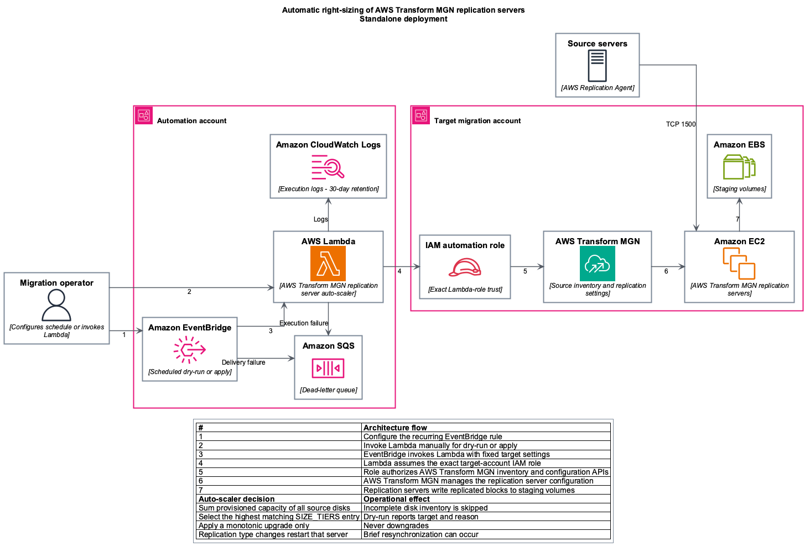

# AWS Transform MGN replication server right-sizing

Companion code for the AWS blog post **Right-sizing replication servers in AWS Transform MGN**.

Repository: [aws-samples/sample-mgn-replication-server-rightsizing](https://github.com/aws-samples/sample-mgn-replication-server-rightsizing)

> **Disclaimer**: This is sample code intended to demonstrate a pattern. It is not production software. Review, test, and harden it — including IAM scope, invocation access, logging, and monitoring — against your own security requirements before deploying to any production environment.

The AWS Lambda function inventories every non-archived AWS Transform MGN source server in one configured account and AWS Region. It sums the provisioned capacity reported for all source disks, selects an instance type from configurable size tiers, and can update the AWS Transform MGN replication server configuration. The function defaults to dry-run.

> This sample uses **provisioned source-disk capacity**, not occupied filesystem space or replication progress. Review the default tiers for your workload, AWS Region, quotas, and cost requirements before enabling updates.

## Architecture

### Standalone deployment



An SVG version is available in [`docs/images`](docs/images/).

## Repository layout

```text
.
├── README.md
├── LICENSE
├── CODE_OF_CONDUCT.md
├── CONTRIBUTING.md
├── SECURITY.md
├── .gitignore
├── .gitattributes
├── src/
│   └── replication_autoscaler.py
├── iam/
│   └── automation-policy-commercial.json # Replace ARN placeholders before use
├── events/
│   ├── dry-run.json
│   └── apply.json
├── examples/
│   └── complete/                     # One-apply deployment of the entire solution
├── stacks/
│   ├── modules/
│   │   ├── autoscaler/               # Shared Lambda and execution-role module
│   │   ├── automation-role/          # Shared target IAM role and least-privilege policy
│   │   └── schedule/                 # Shared EventBridge schedule and SQS dead-letter queue
│   ├── standalone/                   # Lambda stack for the deployment account
│   └── target-account/               # Account-guarded automation-role wrapper
└── docs/
    ├── USAGE.md
    ├── authors.md
    └── images/
```

## Prerequisites

- AWS Transform MGN initialized in the target AWS Region, with source servers registered.
- Terraform 1.3 or later.
- The AWS account ID in which the automation stack will be deployed.
- AWS credentials allowed to create Lambda, IAM, CloudWatch Logs, EventBridge, and Amazon SQS resources in the deployment account.
- Credentials for the target account to create or update the role assumed by Lambda.
- AWS CLI v2 for the manual invocation and verification examples.

No Lambda layer or third-party Python package is required. The function uses the Python 3.12 runtime libraries and `boto3` supplied by Lambda.

## Get the code

```bash
git clone https://github.com/aws-samples/sample-mgn-replication-server-rightsizing.git
cd sample-mgn-replication-server-rightsizing
```

Run all commands in this README from the repository root.

## Deployment options

| Option | Use when | Guide |
|---|---|---|
| Complete example | One operator has credentials for both accounts (or a single account hosts everything) | [`examples/complete`](examples/complete/README.md) |
| Separate stacks | Different teams own the deployment and target accounts, or you are adding trust to an existing role | [Deployment sequence](#deployment-sequence) |

Both options use the same shared modules and produce the same resources.

## Deployment sequence

A deployment is fixed to one deployment account, target account, and AWS Region. The provider refuses to operate if the active deployment credentials do not match `deployment_account_id`, and the Lambda execution role is restricted to one exact target role ARN.

### 1. Deploy the standalone stack with writes disabled

```bash
cp stacks/standalone/terraform.tfvars.example stacks/standalone/terraform.tfvars
# Set deployment_account_id and target_account_id.
# Keep enable_schedule=false and auto_update=false.
terraform -chdir=stacks/standalone init
terraform -chdir=stacks/standalone apply
terraform -chdir=stacks/standalone output -raw lambda_role_arn
```

### 2. Create or update the target-account role

Use credentials for the target account:

```bash
cp stacks/target-account/terraform.tfvars.example stacks/target-account/terraform.tfvars
# Set target_account_id and lambda_role_arn to the output from step 1.
terraform -chdir=stacks/target-account init
terraform -chdir=stacks/target-account apply
```

For an existing automation role, add the Lambda execution-role ARN to its trust policy. In commercial AWS Regions, replace `<REGION>` and `<ACCOUNT_ID>` in [`iam/automation-policy-commercial.json`](iam/automation-policy-commercial.json) before comparing it with the existing permissions. In other partitions, use the partition-aware `stacks/target-account` policy as the reference.

### 3. Dry-run and validate

The checked-in event does not contain account or Region values; those are fixed by the deployment.

```bash
aws lambda invoke \
  --function-name mgn-replication-autoscaler \
  --payload fileb://events/dry-run.json \
  --cli-binary-format raw-in-base64-out \
  response.json
python3 -m json.tool response.json
```

Review every server's `source_capacity_gib`, `inventory_complete`, `target_instance`, `should_update`, and `decision_reason`. EventBridge retries target-delivery failures; after EventBridge successfully hands off an asynchronous invocation, Lambda owns function-execution retries. Both exhausted paths use the stack's SQS dead-letter queue, so inspect the message and CloudWatch Logs before replaying it.

### 4. Apply

After reviewing the dry-run, either invoke [`events/apply.json`](events/apply.json) once or set `auto_update=true` in the selected stack and reapply Terraform.

Changing a replication server type restarts that replication server and can cause a brief resynchronization. Run this early in a migration wave, not near cutover. Restrict `lambda:InvokeFunction` for this function to approved operators and automation because any authorized invoker can request apply mode.

## Default tiers

Thresholds use GiB; 1,024 GiB equals 1 TiB.

| Source-disk capacity | Target replication instance |
|---|---|
| Below 3 TiB | No change |
| 3-6 TiB | `m5.xlarge` |
| 6-10 TiB | `m5.2xlarge` |
| 10-14 TiB | `m5.4xlarge` |
| 14-20 TiB | `m5.8xlarge` |
| 20 TiB or more | `m5.12xlarge` |

The function permits baseline-to-tier and lower-tier-to-higher-tier transitions only when the target size suffix is larger. It does not downgrade. Current types outside the configured baseline and tier sets are left unchanged.

## Operational considerations

- One invocation processes every non-archived source server in the configured target account and Region. Use a dedicated migration account/Region or add deployment-specific scoping before production use.
- One invocation processes servers serially. For very large fleets, partition by account/Region or implement a queue/Step Functions fan-out and load-test before production use.
- Updates are not transactional. Some servers can be updated before a later server fails; repeated invocations are designed to continue monotonic upgrades.
- EventBridge target-delivery failures and Lambda execution failures are retried by their respective services; both exhausted paths use the encrypted stack SQS dead-letter queue.
- Reserved concurrency is one, preventing overlapping executions of the same function.
- Larger replication instances increase staging EC2 charges. Lambda, EventBridge, SQS, and CloudWatch Logs can also incur charges.
- Instance availability and quotas differ by AWS Region. Treat the default tiers as a starting point, not a universal performance formula.

## Cleanup

1. Disable the EventBridge schedule first.
2. If required, restore each AWS Transform MGN source server's intended replication instance type; destroying these stacks does not revert AWS Transform MGN replication configuration.
3. Destroy the automation stack and then the dedicated target-account role stack:

```bash
terraform -chdir=stacks/standalone destroy
terraform -chdir=stacks/target-account destroy  # if this sample created the role
```

## Detailed guide

See [`docs/USAGE.md`](docs/USAGE.md) for all variables, event behavior, validation, failure handling, and scenario-specific prerequisites.

## Security

Security is a shared responsibility between AWS and you. This sample includes the following controls by default:

- **No public endpoint.** The Lambda function has no function URL or API endpoint. Only the EventBridge rule (scoped by `aws:SourceArn`) and IAM principals that you grant `lambda:InvokeFunction` can invoke it.
- **Least-privilege cross-account access.** The target-account role trusts one exact Lambda execution-role ARN. Write permissions are scoped to AWS Transform MGN source servers and AWS Transform MGN-managed launch templates in the configured account and AWS Region. Actions that do not support resource-level permissions are constrained with `aws:RequestedRegion`.
- **Account guardrails.** Each Terraform root sets `allowed_account_ids`, so Terraform refuses to run with credentials for an unexpected account.
- **Safe defaults.** The function runs in dry-run mode unless `auto_update` is the JSON boolean `true`. It never downgrades an instance type and skips servers with incomplete disk inventory.
- **Encryption.** The SQS dead-letter queue uses SSE-SQS and denies requests that do not use TLS. CloudWatch Logs encrypts log data at rest by default; set `log_kms_key_arn` to use a customer managed AWS KMS key instead.

Before you deploy to production, review the following:

- **Invocation access.** Grant `lambda:InvokeFunction` only to approved operators and automation. Any authorized invoker can request apply mode.
- **Log and response data.** Function responses and CloudWatch Logs contain source-server IDs, hostnames, disk capacities, and replication settings. Restrict access to the log group and choose a retention period that meets your requirements.
- **Terraform state.** State files can contain account IDs and resource ARNs. Use an encrypted, access-controlled remote backend with state locking. Do not commit state files, plan files, `.tfvars` files, or credentials to source control.
- **IAM policy template.** If you use [`iam/automation-policy-commercial.json`](iam/automation-policy-commercial.json) with an existing role, replace `<REGION>` and `<ACCOUNT_ID>` first. The `stacks/target-account` Terraform stack is preferred because it derives the partition automatically.
- **Monitoring.** Use AWS CloudTrail to audit `UpdateReplicationConfiguration` calls, and alarm on messages in the dead-letter queue.
- **Configuration.** Confirm role trust, policy scope, size tiers, tags, and schedule settings match your environment.

See [SECURITY.md](SECURITY.md) for how to report security issues and for additional production hardening recommendations.

## License

This library is licensed under the MIT-0 License. See [`LICENSE`](LICENSE).
